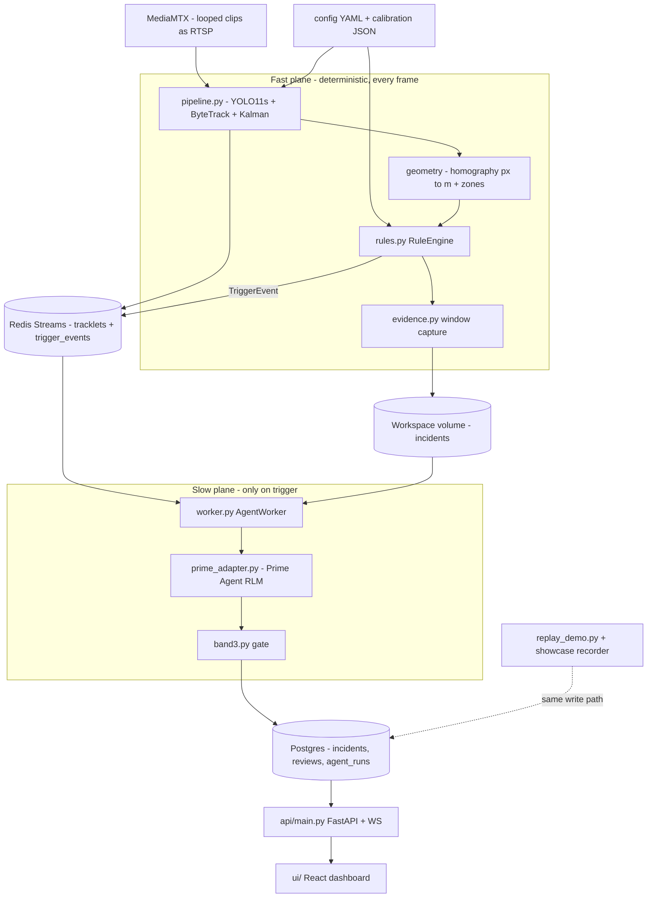
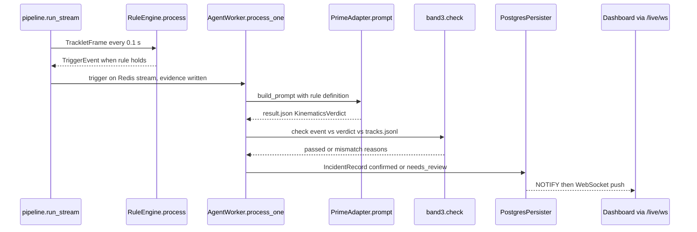

# SiteWatch AI — Master Explainer

Repo: <https://github.com/PCSchmidt/sitework-ai> · Live demo: <https://pcschmidt.github.io/sitework-ai/> · License: MIT (code; the Ultralytics/YOLO11 combination carries AGPL-3.0 obligations — README "License") · Last commit: 2026-09-27 (`defe1b8`)
Status: complete portfolio project (M0–M7 closed, PLAN.md) · active 2026-09-15 → 2026-09-27; activity after [Unknown]
Explainer generated: 2026-10-18 by an AI agent under Chris Schmidt's direction · Questionnaire v1.1 · Depth: LITE (LITE run)

> Tags: **[Verified]** seen in code/config/commits/CI · **[Measured]** read-only command this session (no tests, builds, installs or repo-code execution — `git`/`gh` only) · **[Documented]** stated in repo docs or committed artifacts · **[Author]** confirmed `AUTHOR_CONTEXT.md` line (⚠ lines there = [Inferred]) · **[Inferred]** reasoned · **[Proposed]** not in the repo · **[Unknown]** → §26. Line refs: commit `defe1b8`. One fact, one home: claims §11, discrepancies §24, records §20.

## TL;DR

**V.1 ★** SiteWatch AI watches simulated warehouse/site camera video, measures people and vehicles in meters on the floor, fires fixed safety rules (forklift near a person, person in a hazard zone, speeding vehicle), and when a rule fires sends the tracking data — never raw video — to a Prime Agent RLM that verifies the incident by running Python on it; then plain code (`agent/band3.py`) independently recomputes the key numbers, and only then is the incident stored as `confirmed` or sent to human review. [Verified] `rules.py`, `worker.py`, `band3.py`

**V.2 ★** For safety/ops staff where unverified alarms get ignored and unverified AI numbers are dangerous. The repo reports 35.0 FPS detection at 1080p (3 streams × 30.2 FPS TensorRT FP16 rested, 9.5–13.2 sustained) and agent results (26/30 first-pass on 30 fixtures, all misses timeouts; 82.1% agreement), negative results kept [Documented]. The interest is the discipline: the AI computes instead of asserts, a deterministic gate checks it, and the recorded demo shows the gate catching the agent misclassifying a real intrusion (`ui/public/showcase/evidence/…/earlier_runs.json`) [Verified, L1]. This review adds: the gate's proximity recompute spans the evidence window while the fast plane's claim spans only the current rule state (false `needs_review` risk, W-ARCH-1) [Verified]; the agent's value over just recording the trigger has no measured baseline (W-EVAL-1) [Verified]; speed verdicts pass on schema alone (W-AI-1, disclosed) [Verified] `band3.py:18-19`.

## Repository fact sheet

| Field | Value | Tag / source |
| --- | --- | --- |
| Name | SiteWatch AI (`sitework-ai`) | [Verified] |
| URL · visibility · license | github.com/PCSchmidt/sitework-ai · PUBLIC · MIT | [Measured] `gh repo view` |
| One-line (from code) | YOLO/ByteTrack/homography/rule pipeline → schema-validated trigger → RLM verification → recomputation gate → Postgres/FastAPI/React record | [Verified] |
| Category · flags | physical-AI CV + geospatial safety app · `[UI] [API] [DATA] [MATH] [AI] [AGENT] [DEPLOY]` | [Inferred] |
| Status | "complete (milestones M0–M7)", portfolio project | [Documented] README, PLAN.md |
| Languages / LOC | Python ~10.1k (81 files); TS/TSX ~2.6k; Terraform ~0.9k; YAML ~0.8k; 39 .md docs | [Measured] `git ls-files` |
| Files · tests | 330 tracked; 26 Python test files (184 `def test_`) + 1 UI test (6 cases); repo reports 191 collected (164 offline + 27 Postgres) — not run | [Verified] count; [Documented] README |
| Commits · period | 54 commits, 2026-09-15 → 2026-09-27, one branch, no tags; all authored "Chris Schmidt"; 42/54 carry Claude co-author trailers (37 Sonnet 5, 5 Opus 5.5) | [Verified] `git log` |
| Entry points | `make replay-up`/`make up`; CLIs `pipelines.geometry.calibrate`, `pipelines.vision.record`, `scripts/*`, `evaluation/{agent_eval,benchmark_models,eval_tracking}`; `api/main.py`; `agent/worker.py`; `ui/` | [Verified] Makefile |
| Clean clone | full stack **no** — clips, `yolo11s.pt`, `prime-agent` outside git; `make replay-up` (Docker only) is the zero-setup path, "tested from a fresh clone on 2026-09-26" | [Documented] README, PLAN.md S1; not re-run |
| Tests pass? | [Unknown] this session (no execution); CI green observed in run history | [Measured] `gh run list` |
| CI | `ci` (ruff, mypy, pytest+Postgres, `check_docs.py`, schema-export diff), `ui`, `compose`, `contract-agent` (golden RPC replay), `iac-check` (terraform ×3), `pages`; latest `main` runs success | [Verified] workflows; [Measured] `gh run list` |
| Live demo / media | hosted static dashboard (recorded output + real transcripts); showcase GIF; page not fetched | [Verified] `pages.yaml`; liveness [Unknown] |
| External services | none at runtime (Redis/Postgres/MediaMTX in Docker); agent needs a provider in `~/.prime` (evals: OpenRouter GLM-Flash class); inputs are pinned manual downloads | [Verified] compose, `data/manifests/` |
| AI coding tools | Claude (42/54 trailers); Gemini in ideation artifact `project_concepts_ideas.md`; no `CLAUDE.md`/`AGENTS.md`/`.claude/` tracked | [Verified] |
| Related repos | ⚠ AUTHOR_CONTEXT [Inferred]: physical-AI/edge family; built **without Meridian**, comparison baseline to VERA (B.22) | [Inferred] |
| Headline claims | 15, audited §11 (CL-01…CL-15) | [Verified] |
| Scripts writing tracked files (not run) | `make showcase`/`showcase-agent` rewrite `ui/public/showcase/**`; `generate_report.py` → `docs/benchmarks.md`; `schemas.export` → `schemas/` | [Verified] Makefile |
| Tests needing externals | 27 Postgres integration tests (`integration` marker); contract test replays a committed fixture; no GPU/network tests | [Verified] `pyproject.toml` |

---

## 1. For everyone: what it does and why it matters (A)

**A.1 ★** It watches camera video of a warehouse or site and automatically catches the three situations behind most serious accidents there — a vehicle too close to a person, someone standing in a danger zone, a vehicle going too fast — producing a checked, auditable record of each. [Verified] `rules.py`, README.

**A.2 ★** Before it: a person watching many screens, or a rules-only alarm system whose alerts nobody acts on. [Documented] README "Motivation".

**A.5 ★ Analogy.** A factory with two quality stations. Station 1 (fast plane) is a tireless inspector with a tape measure: every frame she measures where everyone stands, in meters. When her rule says something dangerous happened, she hands a dossier to Station 2 (the AI) — a consultant who reads the numbers, runs calculations, writes an opinion. Before filing, a third person (the gate) re-measures with the same tape; disagreement goes to a human, and nothing is thrown away. [Inferred] from README "The big idea".

**A.10 ★** It cannot see a real site (three looped stock clips), has no forklift/excavator class (trucks stand in; the yard clip boxes only the cab operator), sounds no alarm, quotes meters only where calibration is trustworthy, and its AI verdicts are nondeterministic and only partially gated. [Documented] README "Limitations"; [Verified] `band3.py:18-19`.

Others: information comes from the clips you feed it (A.7); a wrong record surfaces as `needs_review` with a reason — trust geometry and the gate, treat AI class labels as advisory (A.8); the AI re-checks fired events by running code, never decides whether a rule fired (A.9); ~$0.002 per incident (A.11) [Documented]; nothing leaves the machine except LLM calls with tracking numbers; ports bind localhost by default though the API is unauthenticated (A.12); built in ~12 days by Chris Schmidt directing Claude Code (A.13) [Verified]; a paid product needs real sites, alarms, auth, real detector classes (A.15) [Inferred]. All [Verified] unless tagged.

Improvement records: none for Part A.

---

## 2. Purpose, problem, users and use cases (B)

**B.1 ★ Problem.** Sites mixing heavy machinery with people on foot face proximity, zone-dwell and speeding hazards daily; each needs a human to notice it on camera today, and unverified alerts get ignored. [Documented] README.

**B.11 ★ Users.** Primary: a safety/ops engineer wanting automatic explainable incident records (needs Docker). Secondary: a reviewer clearing the `needs_review` queue (`api/main.py` review route). Edge: portfolio viewer on the static demo. Poorly served: real camera estates (no auth, no alarm), PPE compliance needs. [Documented] `docs/01`.

**B.12 ★ Use cases** (inventory §3): measure forklift-near-worker events with evidence — **working** (dock demo 4.20 m); queue unconfirmed events with reasons — **working**; catch zone intrusions — **working** on 1 of 3 demo cameras; see the chain without a GPU — **working** (Pages demo / `make replay-up`); deploy to cloud — **documented only** (validated Terraform, ADR-004).

**B.18 ★ Out of scope.** Real sites/live cameras, alarms/E-stop, PPE, forklift/excavator classes, SaaS, training detectors, live cloud video, the designed multi-agent roles. [Documented] PLAN.md "Non-Goals", `docs/05`.

**B.19 ★ Success measured.** FPS/latency/VRAM matrices; MOTA/IDF1; agent pass rate/agreement/wall time (n=30); terraform validate; test counts. Not measured: PLAN.md S3 (LLM calls per 10-min clip — "Not measured"), user outcomes, real-footage false-alarm rate. [Documented] PLAN.md §3.

Others: B.2 motivation is portfolio-thesis work plus a test of "can an RLM agent run as a headless application component?" [Documented]; idea provenance is `project_concepts_ideas.md` (human vs Gemini share [Unknown]). B.20 failure: a missed incident or an ignored alert. B.22: per ⚠ AUTHOR_CONTEXT [Inferred], built **without Meridian**, serving as the comparison baseline to VERA — the "probabilistic components checked by deterministic gates" thesis in a physical-AI app, gates in plain code instead of the Meridian framework; no shared code. B.23 regulated use: auth, IL hosting, surveyed calibration, real detectors, SBOM [Inferred]; the author works in the defense sector [Author] `AUTHOR_CONTEXT.md` Q6 ANSWER.

Improvement records: W-SCOPE-1 (Low).

---

## 3. Capabilities inventory (B.12, J.1)

| Capability | State | Evidence |
| --- | --- | --- |
| RTSP-simulated ingest (MediaMTX loops clips) | working | [Verified] `docker/mediamtx.yml` |
| Detect + track (YOLO11s, ByteTrack, Kalman) | working | [Verified] `pipelines/vision/` |
| Calibration: DLT points, vanishing points, level camera + motion compensation, 2.0 px gate | working | [Verified] `pipelines/geometry/` |
| Rules: proximity, zone dwell, speed, per-rule cooldowns, severity tiers | working | [Verified] `rules.py:62-271` |
| Evidence capture (tracks.jsonl + clip.mp4 ±5 s) | working | [Verified] `evidence.py` |
| Agent verification via Prime Agent RLM (compute-not-assert) | working; 26/30 fixtures | [Verified] `prime_adapter.py`; [Documented] `docs/eval-m5` |
| Band-3 gate (distance, closing speed, zone dwell) | working | [Verified] `band3.py` |
| Postgres + REST/WS API + dashboard (feed, review queue, KPIs, shift report) | working | [Verified] `api/`, `ui/` |
| $0 replay demo + hosted showcase with real transcripts; recorded camera overlay/floor plan | working | [Verified] `replay_demo.py`, `record.py`, `ui/public/showcase/` |
| Speed-verdict gating; `duration_s`/`ttc_s` gating | **not built** | [Verified] `band3.py:16-19` |
| Alarm consumer on `trigger_events` | **not built** (disclosed) | [Documented] README |
| PPE, forklift/excavator classes, shift synthesizer, compliance auditor, watchdog, harness sub-agents | **planned, not built** | [Documented] `docs/05`, `docs/12` M7 |
| API auth, container hardening, redaction, retention | **designed, not implemented** (disclosed) | [Documented] `docs/08 §2` |
| Cloud deployment | **validated Terraform, deliberately never applied** | [Documented] ADR-004 |

---

## 4. Domain perspective (C)

**C.1 ★** Domain: industrial site safety + camera metrology. Modeled: tracks (persistent identities), ground positions in meters, zones (floor polygons), rules with numeric thresholds and dwell/duration windows, incident states (confirmed/needs_review), classification (normal_ops/near_miss/violation/false_positive). Geofencing usage matches practice; the classification vocabulary and `compliance citation` strings in `config/rules.yaml` are the project's own free text, not a standard taxonomy. [Verified] `models.py`, `rules.yaml`.

**C.2–C.5** Followed: MOTChallenge metrics, Pydantic/JSON Schema. Ignored: OGC/CRS (local metric floor frame — appropriate per camera), OSHA-style categories. Misleading simplifications: a person is a box bottom-center point, so "0.7 m" is center-to-center and understates contact risk; forklifts are truck/bus proxies; floor static per camera. Missing: camera-health as trust input, occlusion uncertainty. [Verified]/[Inferred].

**C.6–C.9** Sources: Pexels clips, YOLO11 weights (AGPL), MOT17 HF mirror (research-only), Mendeley CC BY 4.0 frames, NVIDIA HF stills, one author phone clip — license and SHA-256 pinned in `data/manifests/` [Verified]. Provenance per incident: evidence refs, transcript, rule citation [Verified]; staleness not modeled.

**C.10–C.14** Deterministic geometry/thresholds; the LLM classifies fired events from recomputable data — acceptable subject to calibration error and detector blind spots. Assumptions recorded per camera (±8% dock distances) but numbers are point values to 2 decimals (W-MATH-1). No expert review recorded [Unknown] → §26.

**C.15 ★** For a demo or design review: yes — the measurement chain, fail-safe degradation (uncalibrated → zone-only) and the gate's recorded catches are what a safety engineer wants. For a real decision: surveyed calibration with error bars, real detector classes, an alarm path with latency targets, auth, a real-footage false-alarm study, and the gate gaps closed (W-AI-1, W-MATH-1, W-OPS-1). [Inferred].

Improvement records: W-MATH-1; Low: W-DOM-1.

---

## 5. Codebase guide (D)

**D.1 ★ Tree.** `pipelines/` ★ — vision ★ (`pipeline.py` loop, `detector.py`, `rules.py` ★, `evidence.py`, `kalman.py`, `record.py`), geometry ★ (`homography.py` ★, `vanishing_point.py`, `level_camera.py`, `motion.py`, `zones.py`, `calibrate.py`), broker, schemas ★ (`models.py`), config loader · `agent/` ★ (`worker.py` ★, `prime_adapter.py` ★, `band3.py` ★, `prompts/` ★, `transcript.py`, `persistence.py`, `worker_fallback.py` stub) · `api/` ★ (`main.py`, `db.py`, `repository.py`, `reports.py`, `schema.sql`) · `ui/src/` · `evaluation/` · `config/` ★ (YAML + `calibration/` JSON) · `tests/` (26) · `docs/` (13 numbered + ADRs + spikes) · `docker/` · `deploy/terraform/` · `scripts/` · `data/manifests/` · `schemas/` (generated) · root (`PLAN.md`, `Makefile`, `pyproject.toml`, `uv.lock`, captured Terraform-spec PDF). Deletable: the PDF, `project_concepts_ideas.md`, `ui/public/showcase/` (regenerable). [Verified].

**D.2 ★ Entry points** — fact sheet row. **D.3 ★ Run locally** — Python 3.11+/`uv`; `uv sync` (multi-GB CUDA torch) then `uv run pytest`; `make replay-up` → localhost:5173; the full pipeline needs an NVIDIA GPU, hand-downloaded clips/weights and a vendored `prime-agent` (not on npm) — a fresh clone cannot run `make up` as-is (PLAN.md S1 "Partly met"). Not executed this session; the repo reports the replay path tested from a fresh clone 2026-09-26. [Documented].

**D.7 ★ Key code.** `RuleEngine.process` (`rules.py:71`); `Homography.solve` + `calibrate_level_camera`; `pipeline.py run_stream`/`build_tracks`; `AgentWorker.process_one` (`worker.py:189`); `PrimeAdapter.prompt` (`prime_adapter.py:167`, 210 s supervisory kill); `band3.check` (`band3.py:155`); `pipelines/schemas/models.py`; `api/main.py`. [Verified].

**D.8 ★ The function.** `band3.py:155 check(...)`: load the stored window; recompute min distance and closing velocity (or zone dwell) with the rule engine's own math; compare both the fast plane's and the agent's claims within 0.15 m / 0.2 m/s / 5% (0.2 s dwell); disagreement becomes a `needs_review` reason and the caller stores the incident either way. The thesis in 50 lines: probabilistic output is not trusted until deterministic code has re-derived it. [Verified].

**D.17 ★ README accuracy.** Accurate and self-critical; `scripts/check_docs.py` gates doc consistency in CI. This review found 3 discrepancies (§24); the most visible is the GitHub description's "multi-agent operations platform" while one agent role runs. [Verified]; [Measured] `gh repo view`.

Improvement records: Low: W-CODE-1.

---

## 6. Tech stack and rationale (E)

| Layer | Technology | Why (tag) | Alternatives |
| --- | --- | --- | --- |
| Language | Python 3.11; torch 2.11+cu128 pinned | CV/ML ecosystem, one language [Inferred] | Go, Rust, TS |
| Perception | Ultralytics YOLO11s + ByteTrack + own Kalman | spike-00 picked 11s [Documented] | RT-DETR, YOLOX |
| Geometry | NumPy SVD DLT, Shapely, ORB+RANSAC | auditable [Verified] | OpenCV built-ins |
| Broker | Redis Streams + consumer groups | ADR-002 local simplicity | Kafka, SQS |
| Agent | Prime Agent 0.9.3 (RLM) over JSON-lines RPC | ADR-005 compute-not-assert | LLM API, LiteLLM stub |
| DB/API | Postgres 16 + FastAPI + WS (NOTIFY) | [Verified] `api/` | SQLite, Django |
| UI | React + Vite + Tailwind | [Verified] `ui/` | static HTML |
| Contracts | Pydantic v2 + exported JSON Schema | docs/06 | Zod |
| Infra | Compose local; Terraform ×3 validate-only | ADR-004 $0 | live cloud |
| Quality | pytest (+Postgres), ruff, mypy strict (pipelines/agent/api), npm test, Actions | [Verified] workflows | pre-commit |

Trade-offs accepted in order: perf; AGPL; care needed; demo-scale; private package; one DB user; thin tests; strict churn; no ops evidence; untyped scripts.

**E.1 ★** Python for the CV ecosystem and one language across planes; the deterministic core is plain Python + NumPy so it can be re-derived by hand. Go/Rust would buy throughput at the cost of the detector ecosystem. [Inferred].

**E.3 ★ Load-bearing:** Ultralytics, torch, Pydantic (every contract incl. gate inputs), FastAPI/asyncpg, redis (queue + reclaim), `av`, Shapely. Risky: torch+ultralytics (multi-GB, AGPL); `prime-agent` (not on public npm — the agent container builds from a vendored tarball; CI verifies the adapter by replaying a golden session, not the live CLI) [Verified] `docker/vendor/README.md`.

**E.5b ★ Drift.** `uv.lock` + `package-lock.json` committed; CI `uv sync --frozen || uv sync`; torch pinned exact. Committed results record **no** package or model versions (transcript fixture names `z-ai/glm-5.3-flash`), so fresh-resolve reproducibility cannot be shown; no resolve attempted (run brief). [Verified]; [Inferred] risk.

Improvement records: W-STACK-1.

---

## 7. Architecture: diagrams, execution walkthrough, ADR table (F)

**F.1 ★ Style.** Event pipeline + client–server delivery: per-camera streaming workers → Redis Streams → single-consumer verification worker → Postgres → FastAPI/WS → React, organized as the two-plane split with a deterministic gate between (ADR-001). **F.2 ★ Components.** Vision worker per camera (detect, track, project, rules, evidence); Redis Streams broker; agent worker (queue → Prime Agent RPC → schema validation → Band-3 → persistence); shared evidence volume; Postgres + NOTIFY; FastAPI; React dashboard; replay/showcase scripts. [Verified].

**F.3 ★ One incident end to end** (dock demo). MediaMTX loops the clip → `pipeline.py run_stream` decodes (`av`), `build_tracks` runs detector + ByteTrack + Kalman + motion compensation → `Homography.apply` projects box bottom-centers to meters → `RuleEngine.process` emits a `TriggerEvent` when `exclusion_mobile_plant_dock` holds (4.20 m) → `EvidenceCapture` writes the ±5 s window → `worker.py _handle` pops the entry; `process_one` stages files; `build_prompt` inserts the rule definition → `PrimeAdapter.prompt` runs `prime-agent --mode rpc` (≤210 s) → `KinematicsVerdict` validation → `band3.check` recomputes 4.20 m → `IncidentRecord(confirmed, normal_ops)` → `PostgresPersister.persist` → `incidents_notify` → `/live/ws` push → dashboard. Outcome [Verified, L1] `incidents.json`.

**F.8 ★ Contracts.** `pipelines/schemas/models.py` (`TrackletFrame`, `TriggerEvent`, `KinematicsVerdict`, `IncidentRecord`, `CalibrationQuality`, `AgentRunStats`; `extra="forbid"`), JSON Schemas exported with a CI freshness check, config YAML validated at load, `api/schema.sql`; gate tolerances in docs/06 §3 and code constants (`DISTANCE_TOL_M=0.15`, `VELOCITY_TOL_MPS=0.2`, `TIME_TOL_S=0.2`, `RELATIVE_TOL=0.05`) [Verified].

**F.11 ★ Invariants** (static; adversarial probes skipped — this run executes nothing, §27): (1) metric rules never fire on untrustworthy calibration (`rules.py:174,259`); (2) nothing reaches `confirmed` without schema + gate pass (`worker.py:232-259`); (3) nothing silently dropped — no ack on crash/persist failure (`worker.py:172-187`); (4) plane crossings schema-typed. Attacks from reading: (2) holds with designed gaps (speed ungated, `ttc_s` unchecked — W-AI-1); (3) holds at the cost of at-least-once reprocessing (idempotent upsert); one latent defect in the two "minimum distance" spans (W-ARCH-1) [Verified]; reachability [Inferred].

**F.19 ★ Scale.** 10× streams: one-GPU-per-camera plus laptop thermal throttling break first — sustained-load numbers show 3× per-stream FPS loss from heat alone [Documented]. 100×: single agent worker (~1 incident/minute) and single Postgres queue up [Inferred]. 1000×: shared-volume evidence storage dominates [Inferred].

**F.22 ★ SPOF.** The agent worker (one consumer, one prime-agent process per incident, no fallback): if it or the provider is down, triggers pile up in Redis and nothing is confirmed — fail-safe but silent. Postgres is a second SPOF. [Verified].

**F.24 ★ ADR table** (repo ADRs 001–005):

| # | Decision | Evidence | Alternatives | Gained | Sacrificed | Reversible · right? |
|---|---|---|---|---|---|---|
| 1 | fast/slow planes + gate | ADR-001 | pure rules; pure LLM | determinism where it matters | two code paths | yes · yes |
| 2 | Redis Streams local | ADR-002 | Kafka, SQS | zero ops | durability | yes · yes |
| 3 | YOLO11s default, proxy classes | ADR-003, spikes | 11n, RT-DETR | free 1080p speed | forklift class | yes · yes |
| 4 | cloud = validated Terraform only | ADR-004 | live deployment | reproducible IaC | no ops evidence | yes · yes |
| 5 | Prime Agent embedded, pinned, external timeout | ADR-005, spike-01 | LiteLLM stub | the core demo | reproducibility | partly · yes |

Improvement records: W-ARCH-1.

Improvement records: W-ARCH-1.

---

## 8. Data architecture (G)

**G.1 ★** Enters: decoded frames (never stored) + config YAML. Transient: `TrackletFrame`s (~10 Hz/camera) through Redis Streams. Stored: per-incident evidence (`tracks.jsonl` + `clip.mp4`, ±5 s; demo incidents 37–86 KB JSON + ~1 MB clip), `IncidentRecord`/`reviews`/`agent_runs` in Postgres, showcase artifacts in `ui/public/showcase/`. Leaves: JSON over REST/WS, HTML shift reports. [Verified].

**G.3 ★ Model.** `TrackletFrame{camera_id, frame_ts, seq, calibration_quality, tracks[]}`; `Track{track_id, cls, confidence, bbox_px, ground_point_m?, velocity_mps?, speed_mps?, state, zone_ids, ppe}`; `TriggerEvent{event_id, rule_id, severity_hint, metrics{min_distance_m,duration_s,closing_speed_mps}, involved_track_ids, evidence refs, cooldown_key}`; `KinematicsVerdict{verified_min_distance_m, closing_velocity_mps, ttc_s, classification, recompute_inputs}`; DB tables per `api/schema.sql`. Models `extra="forbid"`; inputs carry SHA-256 manifests; incidents upsert on `event_id`; no retention (disclosed `docs/06 §6`) [Verified].

Improvement records: none above Low (retention in W-OPS-1).

---

## 9. Algorithms and mathematics (H)

The mathematical machinery in SiteWatch AI exists to answer one question honestly: **how far apart were they, really, in meters?** A camera reports pixels, and pixels are not meters. The core math converts picture coordinates into floor coordinates so a rule like "3 metres for 2 seconds" means three real metres, then re-derives the same numbers a second time behind the AI's back. The everyday analogy is standing at the end of a warehouse aisle: lines parallel in the real world squeeze toward one point on the horizon, objects whose feet sit lower in your view are closer, and if you know how high your eyes are above the floor, "how far below the horizon" becomes "how far away". That is exactly what the calibration math does; everything downstream — distances, speeds, dwell times, the gate — is ruler work on the floor positions it produces. [Verified] `pipelines/geometry/`, `rules.py`, `band3.py`.

### Central method 1 — the floor mapping (homography from matched points)

**Plain language.** Someone marks a few spots identifiable both in the picture and on the floor — "that floor joint crosses this pixel" — and the code learns the one conversion rule that sends *any* pixel to a floor position, absorbing the camera's tilt, zoom and perspective in a single 3×3 grid of numbers. Think of unwarping a tilted photo of a tiled floor: four recognisable tiles are enough to recover how the picture was squeezed.

**Formal statement.** For matched points $(x_i, y_i)$ in the image (pixels) and $(u_i, v_i)$ on the floor (meters), find the 3×3 matrix $H$, unique up to an overall factor, such that $(u_i, v_i, 1)^T \sim H\,(x_i, y_i, 1)^T$, where "$\sim$" means "equal up to a common factor" and $T$ means "written as a column". Each match contributes two rows to a design matrix $A$: $(-x_i, -y_i, -1, 0, 0, 0, u_i x_i, u_i y_i, u_i)$ and $(0, 0, 0, -x_i, -y_i, -1, v_i x_i, v_i y_i, v_i)$; $H$'s entries are the right singular vector of $A$ for its smallest singular value (in plain terms: the single 9-number combination that best satisfies all the matches at once), reshaped into a 3×3 grid and scaled so its bottom-right entry is 1. [Verified] `homography.py:37-47`, `homography.solve` (`homography.py:25`).

**Worked example (illustrative round numbers, not a repo measurement).** If a camera looks straight down so the floor scales evenly at 100 pixels per metre with the origin at the image's bottom-left, then $H$ is just "$u = x/100$, $v = y/100$" and the pixel $(300, 450)$ lands at $(3.0\,\mathrm{m}, 4.5\,\mathrm{m})$ — checkable in your head. A tilted camera's skew and squeeze are recovered the same way from four or more matches.

**Assumptions and limits.** At least 4 non-collinear matches on one flat floor. The solve skips the usual pre-scaling of coordinates (Hartley normalization), so conditioning on 1920-pixel coordinates is a real concern [Inferred]; and with exactly 4 points the fit is *exact*, so its residual `rms_px` is ≈0 — the 2.0 px quality gate (`homography.py:70`) only bites on over-determined picks (5+ points). [Verified].

### Central method 2 — measuring from one photo and one honest guess (vanishing-point / level-camera metrology)

**Plain language.** Often nobody surveyed the floor — the demo clips are stock footage. This method squeezes geometry out of the picture itself: world-parallel lines (floor joints, wall tops, window sills) converge in the image to one vanishing point, which tells the code where the horizon is and how the camera tilts. What the picture cannot give is *scale* — meters per pixel — so one real-world measurement is required: how high the camera sits. Given that one guess, every floor position becomes a distance in meters.

**Formal statement.** For traced line segments $\ell_i$ assumed parallel in 3D, their vanishing point $v$ minimizes $\sum_i d(\ell_i, v)^2$, the summed squared distances from the point to the lines, solved by the same smallest-singular-value trick (`vanishing_point.py:46`). Focal length $f$ (pixels) follows from two perpendicular directions with vanishing points $v_1, v_2$ and image center $c$: $(v_1 - c)\cdot(v_2 - c) + f^2 = 0$ (`vanishing_point.py:72`). With camera height $h$ in meters — the single assumed measurement — the ground mapping is $H = [-h\,x_{axis};\; -h\,y_{axis};\; up]\,K^{-1}$, where $x_{axis}, y_{axis}, up$ are the camera's floor-aligned axes and $K$ is the intrinsics matrix built from $f$ and $c$ (`level_camera.py:54-85`). [Verified]. The three-vanishing-point form is adapted (`vanishing_point.py`); the one-point "level camera" special case for a view straight down an aisle is adapted (`level_camera.py:54`).

**Worked example (real, from the dock calibration).** 11 traced aisle lines converge on the vanishing point $(975.15, 512.29)$ px with residual RMS 1.21 px, passing the 2.0 px gate. For scale: the forklift's 0.98 m rear wheel track spans 225 px at a contact row 307 px below the horizon, giving $h \approx 0.98 \times 307 / 225 \approx 1.34$ m; a 1.70–1.75 m worker gives 1.46–1.50 m; the file takes $h = 1.40$ m between them. Head-check of the depth rule: at $f = 3500$ px, a floor point 350 px below the horizon is $1.40 \times 3500 / 350 = 14$ m away (illustrative round numbers). Assumptions recorded verbatim in `config/calibration/dock_north_01.json` [Verified].

**Assumptions and limits.** Pinhole camera, genuinely parallel lines, zero roll, and a trustworthy $h$; focal length is assumed (3500 px; the file notes a plausible 3000–4400 px range, affecting only depth-axis distances). Crucially, the 1.21 px quality number measures only how consistently the traced lines agree on *one* vanishing point — not scale accuracy — so every distance carries the ±8% uncertainty of the height estimate (W-MATH-1; `level_camera.py:22-27` says the same).

### Central method 3 — the tape measure the AI may not argue with (shared distance math)

**Plain language.** Once floor positions exist, "how close did the forklift get" is ordinary ruler work, done twice by design: the rule engine computes it to decide whether an alert fires, and the gate computes it again from stored raw data to check what the fast plane claimed and what the AI answered. Closest approach is the smallest per-frame distance; closing speed is how fast that distance shrank before the closest point; zone dwell is how long someone stayed inside a drawn area without stepping out.

**Formal statement.** For floor positions $(x_a, y_a)$ and $(x_b, y_b)$, the per-frame distance is $d_t = \sqrt{(x_a - x_b)^2 + (y_a - y_b)^2}$; the claim is $d_{min} = \min_t d_t$; closing velocity is $(d_{t-1} - d_t)/\Delta t$ evaluated at the min-distance frame; dwell is $t_{last} - t_{entered}$ for the unbroken run of in-zone frames ending at the trigger (`rules.py:165-248`, `band3.py:67-125`). [Verified].

**Worked example.** One track at $(0, 0)$, another at $(3, 4)$: by the 3-4-5 triangle they are 5 m apart. One second later the second track is at $(0, 3)$: 3 m apart, so over that second they closed at $(5 - 3)/1 = 2$ m/s and the closest approach so far is 3 m.

**Assumptions and limits.** A flat floor and trustworthy ground points; the gate compares claims within 0.15 m / 0.2 m/s / 5% (0.2 s for dwell; `pipelines/schemas/models.py`). Two limits are visible in the code: speed verdicts are never recomputed (W-AI-1, `band3.py:16-19`), and the gate takes its minimum over the whole stored window while the rule engine's claim covers only the current approach — an earlier dip in the window can force a false `needs_review` (W-ARCH-1, `band3.py:79-92` vs `rules.py:207-221`).

### The rest of the pipeline's mathematics

**H.1 ★ Inventory.** Everything else is standard machinery, either a library call or a small adaptation; the table gives one plain-language clause each, and marks the central methods above — they decide what "3.0 m" means and what the gate checks (central vs incidental, H.3).

| Method | Where | Kind | What it does, in plain words |
| --- | --- | --- | --- |
| Planar homography DLT+SVD | `homography.py:25` | standard | the floor mapping of method 1 (central) |
| Vanishing point from ≥2 lines | `vanishing_point.py:46` | standard | finds where world-parallel lines converge in the picture (central) |
| Focal length from orthogonal VPs | `vanishing_point.py:72` | standard | recovers lens zoom from two perpendicular directions |
| Ground homography from 3 VPs + assumed height | `vanishing_point.py` | adapted | method 2's general case when two horizon directions are visible |
| Level-camera homography | `level_camera.py:54` | adapted | method 2's one-point case for a view down an aisle (central) |
| ORB+RANSAC motion compensation | `motion.py` | library | realigns each handheld frame onto the calibrated frame |
| ByteTrack + Kalman + 1 s velocity window | `kalman.py`, `pipeline.py` | standard | keeps one identity per person/vehicle, smooths jittery speeds |
| Pairwise distance, closing speed, dwell, TTC | `rules.py:165-248`, `band3.py:67-125` | standard | method 3's shared tape measure (central) |
| RMS reprojection gate (2.0 px) | `homography.py:70` | adapted | quality gate deciding whether metric rules may run |
| MOTA/IDF1 | `eval_tracking.py` | library | standard tracking-accuracy scores |

Methods 1–3 are written from scratch on NumPy SVD; tracking (ByteTrack via Ultralytics), image alignment (ORB+RANSAC) and the tracking scores (`motmetrics`) are library calls, with the Kalman smoother as the project's own module (`kalman.py`) [Verified]. Each solve is one tiny SVD — negligible next to video decoding, where the compute bottleneck lives (§14).

**H.17 ★ Assumptions (whole chain).** Pinhole camera, planar floor, zero roll, known camera height. Failures are documented: handheld drift up to 65 px is compensated frame by frame (`motion.py`), lens distortion is unmodelled, and a wrong height scales every distance proportionally. Degradation is safe: a calibration failing the 2.0 px gate keeps zone detection but switches metric distance and speed rules off rather than report untrustworthy meters (`rules.py:174,259`). [Verified]/[Documented].

Improvement records: W-MATH-1; Low: W-DOM-1.

---

## 10. AI/ML and agent architecture (I)

**I.1 ★ Hybrid.** Deterministic: fast plane + Band-3 gate. Probabilistic: one LLM (Prime Agent RLM) classifying already-fired events. Boundary: schema-validated `TriggerEvent` + tracking window; raw video never crosses. [Verified].

**I.2 ★ Model calls.**

| Call site | Model | Where | Task | In → out | Tokens | Latency | Cost | Fallback |
|---|---|---|---|---|---|---|---|---|
| `prime_adapter.py:167` | prime-agent 0.9.3 RPC; transcript shows `z-ai/glm-5.3-flash` | provider API (`~/.prime`) | verify one incident | prompt + `tracks.jsonl` → `result.json` | runs 10.6–62.6 K; eval 43.5–56.2 K [Documented] | p50 68.8 s | ~$0.002 | none — timeout/crash → `needs_review` |
| `detector.py` | YOLO11s | local GPU | detection | frame → boxes | n/a | 9–21 ms | $0 | none |

**I.8 ★ Output control.** Only `result.json` is consumed; `KinematicsVerdict` validation (`extra="forbid"`) is the acceptance test; missing/invalid output, timeout (210 s supervisory kill — spike-01 proved the CLI's caps untrustworthy) or crash → `needs_review` with reason. [Verified] `worker.py:224-246`.

**I.9 ★ Gates.** Band-3: proximity — recompute min distance over the stored window; reject if the fast plane's `metrics.min_distance_m` **or** the agent's `verified_min_distance_m` differs by >0.15 m/5%; compare agent closing velocity (>0.2 m/s/5%). Zone — recompute continuous dwell at trigger; reject `violation` without the limit met or `false_positive` with it met (0.2 s). Pass-through on schema alone: speed triggers, `ttc_s`, `duration_s`, `normal_ops`/`near_miss` judgment classes (rationale in the module docstring). The demo shows the gate rejecting an agent `false_positive` with a quoted 3.00 s recompute (`earlier_runs.json`) [Verified, L1].

**I.18 ★ AI value.** The essential AI feature is narrow: classifying fired events with context rules lack. A rules-only classifier would likely score similarly — the proximity prompt's cutoffs (<2.0 m near-miss, <1.0 m violation) are deterministic thresholds — and the repo never measures the difference (W-EVAL-1). Current standing: the AI demonstrates *checked* probabilistic judgment, not a measured accuracy upgrade. [Verified] prompts; [Inferred] rest.

Improvement records: W-AI-1, W-EVAL-1.

---

## 11. Evaluation, results and claims audit (J)

**J.1 ★ Claims audit** (L1 = doc matches committed artifact; nothing re-run, so no L2):

| ID | Claim (source) | Checked against | Verdict |
|---|---|---|---|
| CL-01 | 191 tests (164+27) + 6 UI (README) | 184 `def test_` counted, not executed | Partial (L1) |
| CL-02 | YOLO11s 35.0 FPS 1080p (README) | `benchmarks.md` 35.0 + raw JSONL | Supported (L1) |
| CL-03 | 3×30.2 FPS rested, 9.5–13.2 sustained (README) | M5 tables + raw JSONL | Supported (L1) |
| CL-04 | agent 86.7% first-pass; 100% after timeout fix (README) | report 26/30 ✓; "100%" = 4-fixture retest + extrapolation (disclosed) | Partial (L1) |
| CL-05 | 82.1% agreement (README) | report 23/28 ✓ | Supported (L1) |
| CL-06 | median verification 68.8 s (README) | report `p50_wall_s` ✓ | Supported (L1) |
| CL-07 | ~43–56 K tokens, ~$0.002/incident (README) | `docs/10` band; demo records 10.6–62.6 K | Partial (L1, §24 D-2) |
| CL-08 | MOTA 0.16–0.46 MOT17 (README) | 0.158–0.459 + raw JSONL | Supported (L1) |
| CL-09 | Terraform validated ×3, never applied (README) | `iac-check.yaml`, ADR-004 | Supported (L1) |
| CL-10 | demo: dock 4.20 m → normal_ops; aisle 3.0 s → violation (README) | `incidents.json` 4.2028894 m ✓, `confirmed` ✓ | Supported (L1) |
| CL-11 | gate caught the agent's false_positive (README) | `earlier_runs.json` reason + transcript ✓ | Supported (L1) |
| CL-12 | live demo works today (README) | `pages.yaml` + green `pages` runs [Measured] | Supported (deploy); liveness [Unknown] |
| CL-13 | dock calibration 1.21 px passes gate (README) | `dock_north_01.json` ✓ | Supported (L1) |
| CL-14 | S2 met ≥25 FPS ×3 (PLAN.md) | both benchmark matrices ✓ | Supported (conditional on GPU state) |
| CL-15 | ±8% distance uncertainty (README) | calibration JSON assumptions — estimates | Supported as estimate |

**J.2 ★ Harness.** `evaluation/agent_eval.py` (30 hand-built fixtures through the real `AgentWorker.process_one` against the real CLI), `benchmark_models.py` (FPS/latency/VRAM + thermal snapshots), `eval_tracking.py` (MOTA/IDF1 vs MOTChallenge GT, 200-frame caps); `make` targets; method in `docs/09` [Verified]. **J.3 ★ Numbers:** in the CL table; all carry n and raw artifacts; none carry confidence intervals; the repo keeps raw 86.7% beside adjusted 100% and throttled FPS beside best case [Documented]. **J.4 ★ Baselines:** tracking is self-described "baseline, not a claim"; detection compares 11n vs 11s only; agent verification has **no deterministic baseline** — nothing measures what the slow plane adds over recording the trigger's own numbers (W-EVAL-1) [Verified]. **J.12 ★ Pre-registration:** not claimed; spikes precede decisions (spike-00 → YOLO11s, spike-01 → timeout). n/a. **J.13 ★ Leakage:** the fixture set was hand-built alongside the prompts and carries a self-caught labeling error (`docs/eval-m5`), so classification agreement is an upper bound for real footage [Documented].

---

## 12. Testing and code quality (K)

**K.1 ★** 26 Python test files: unit (geometry, schemas, rules, kalman, config), Postgres integration (`integration` marker, CI service container), a golden-session contract test (replays `tests/fixtures/golden_prime_agent_session.jsonl` through `PrimeAdapter` against `tests/_fake_prime_agent.py`), behavioral worker/gate tests; 184 test definitions counted [Verified] (191 collected [Documented]). 6 UI unit tests, no component/e2e (disclosed).

**K.2 ★** Not run (run brief). CI: ruff, mypy (strict; `pipelines`/`agent`/`api` only), pytest+Postgres, `check_docs.py`, schema-export diff; latest runs green [Measured] `gh run list`. **K.4 ★** README's "ruff, mypy, UI type-check and build clean, all green in CI" matches the workflows item for item; no claim exceeds CI. `evaluation/`, `scripts/`, `tests/` are outside mypy scope [Verified].

**K.6 ★ Spot-checks (AI-written tests).** `test_band3.py::test_zone_dwell_recompute_counts_the_run_ending_at_the_trigger` asserts an exact 2.0 s recompute over a hand-set frame pattern — behavior, not implementation; `…::test_zone_gate_tolerates_float_dwell_just_under_the_limit` encodes the real showcase float-epoch edge case; `test_worker.py` asserts the prompt carries the rule definition — pins the M7 fix. All test real behavior. [Verified].

**K.10 ★ Missing.** Invented test: a pair that dips inside the radius briefly, exits, re-enters and triggers — per W-ARCH-1 expected to produce a false `needs_review`. Also untested: oversized windows, out-of-order `frame_ts`, `track_id` reuse. [Inferred].

Improvement records: Low: W-TEST-1.

---

## 13. Security, privacy and compliance (L)

**L.1 ★** Assets: telemetry, incident records, LLM credentials (`~/.prime` mount), the agent's code-execution ability. `docs/08` holds a STRIDE-lite threat model whose 2026-09-26 review marks each control implemented/partial — most container hardening is **design only** [Verified].

**L.2 ★ Surfaces.** Free-string fields (`rule_id`, `cls`) reaching prompt context; model output (`result.json`, schema-gated); the agent's REPL (arbitrary Python in a container); evidence paths (mitigated: `event_id` regex-validated before filesystem use); unauthenticated REST/WS if `BIND_ADDR=0.0.0.0` is opted into [Verified].

**L.5 ★ Secrets.** Provider keys in `~/.prime`, `.env` ignored, compose carries a disclosed dev DB password. Tracked-file scan + history pickaxe for key patterns found no committed secrets (matches: `task-sg` names, an `sk-REDACTED` placeholder, npm URLs) [Measured].

**L.13 ★ Review first.** (1) agent container: `cap_drop`, read-only rootfs, egress allowlist (designed, absent); (2) prompt-injection handling + red-team fixtures (none — disclosed `docs/11` R9); (3) anything beyond localhost binding needs authentication first. [Verified].

Improvement records: W-SEC-1.

---

## 14. Performance, reliability, deployment, operations, cost (M)

**M.1 ★** Dominant: video decode (4K bottleneck; 1080p transcodes fix it), GPU inference (9–21 ms/frame), per-incident agent wall time (40–110 s, p50 68.8 s). Measurements are the repo's matrices with thermal snapshots and raw JSONL [Documented].

**M.9 ★** Local Docker Compose (full stack: GPU + manual downloads; replay stack: Docker only). Hosted: the static Pages demo only; cloud Terraform validated, never applied (ADR-004). `pages` runs succeed [Measured]; page liveness [Unknown].

**M.16 ★ Cost.** Local $0 infra + ~$0.002/incident LLM (measured band `docs/10 §2`; demo incidents ~$0.004 to record). Scales with incidents, not video: Scenario B (10 sites × 200 incidents/day) ~$70–170/mo, dominated by always-on managed DB/broker floors (~$20–80) and LLM (~$20–60) [Documented, repo-tagged directional]. Latent risk: no per-day budget alarm (disclosed).

Improvement records: W-OPS-1.

---

## 15. Alternatives and trade-offs (N)

**N.1 ★** Two fundamentally different builds: rules-only CV product (cheap, deterministic, drowns users in false alarms — the README's named failure mode) and pure-LLM video analysis (contextual but slow, costly, confidently wrong). The hybrid is right for a portfolio goal because the *verification architecture* is the point. A third option — CV + rules + deterministic kinematics classifier, no LLM — likely delivers the same fixture accuracy (W-EVAL-1). [Inferred].

**N.2 ★ 80% version.** Fast plane + rules + deterministic classification + Postgres/API, no agent or gate. The current build adds them; justified only as a demonstration of checked probabilistic judgment, which is the stated purpose [Documented] README — so justified, but its accuracy value is unproven (W-EVAL-1).

**N.12 ★ Biggest design weakness, plainly.** The metric layer rests on hand-estimated calibration (camera height from a forklift's wheel track; focal length "a typical lens") with a gate that measures only geometric consistency, while numbers are presented to 0.01 m — precision the ±8%+ scale uncertainty does not support (W-MATH-1). [Verified].

Improvement records: none new.

---

## 16. Development history and timeline (O)

**O.1 ★** 2026-09-15 plan/concept + MIT license (Gemini-aided ideation artifact) → M0 scaffold + CI; dataset manifests → M1 perception + spike-00 (YOLO11s default; weights uncommitted `e323417`) → spike-02 forklift-class decision (proxies ship) → M2 geometry/rules/evidence/broker with honest real-calibration failures → M3 spike-01 → Prime Agent adapter + 10-incident eval → M4 Postgres/API/dashboard → M5 30-incident eval + benchmark matrices + MOT17 → M6 Terraform ×3, runbooks, cost model, replay mode, two geometry bug hunts (`4916a2`… see `51e6b47`) → post-M6 doc review fixing undisclosed design/build gaps (`b741a11`) → M7 showcase recorder, demo-camera calibration, five real bugs fixed with tests, hosted demo → `defe1b8` binds ports to localhost. [Verified] `git log`, `docs/12`. Shape: 54 commits in 12 days, milestone batches, negative-result commits kept (`c7f64f6`, `098e0a4`); no squashing evidence [Inferred].

Improvement records: none.

---

## 17. How it was built: human + AI collaboration (P)

**P.1 ★** 42/54 commits carry `Co-Authored-By: Claude Sonnet 5` (37) or `Claude Opus 5.5` (5) [Verified]; Gemini in the ideation conversation `project_concepts_ideas.md` [Verified]; README credits Claude Code and says Prime Agent is a runtime component, not the builder [Documented]. [Author] "mostly I used the same tool across an entire project with limited exceptions" (Q4 ANSWER), and the build tools named are "Mostly Claude Code but also Github Copilot, Codex, Prime-Agent" (Q3) — the latter leaves no commit-trailer trace and is in tension with the README line above (§26 flag). Per-phase split beyond that: [Unknown].

**P.2 ★** Share: [Author] "Very little code written by Author … all development work done by LLMs and agents. Mostly Claude Code but also Github Copilot, Codex, Prime-Agent with a variety of LLMs" (`AUTHOR_CONTEXT.md` Q3 ANSWER) — this **confirms** the previously ⚠ "agents wrote most of the code under Chris's direction" line. Per-repo split, per-phase tool mix and architecture share remain [Unknown] (§26).

**P.3 ★** Author decisions evidenced by judgment artifacts: keep cloud validate-only (ADR-004); publish throttled numbers beside best case; keep the mislabeled fixture unfixed to avoid moving goalposts (`docs/eval-m5`); scope to one agent role and document the unbuilt design (`docs/05`). Per-line attribution: not done [Unknown] → §26.

**P.7 ★** No instruction files tracked. Functional equivalents: the doc suite (docs/01–13), PLAN.md, and `scripts/check_docs.py` — a machine-checked consistency gate over the docs [Verified].

**P.12 ★** Verification before acceptance, evidenced: CI gates, spike-driven decisions, golden-session contract replay of the real agent's RPC, honest calibration attempts, M7 bug hunts fixed with tests, recurring `docs: align doc suite with reality` commits [Verified].

**P.13 ★** Evidenced product/agent failures (attribution only where the repo says so): the agent misclassified a real intrusion — transcripts showed why (prompt lacked the rule definition) [Documented] `docs/12` M7; prime-agent's turn caps failed to stop a runaway (spike-01 Finding 4); the RPC pipe garbled UTF-8 on Windows. Defects this review found are defects, not proven agent mistakes. **P.19 ★** Explains unaided: two-plane design, gate, rule engine, calibration derivations. Would need re-study: prime-agent internals, ByteTrack behavior, Terraform details [Inferred].

**P.26–P.27 ★ Gates.** No gate framework (`gates.yaml` absent); approval identity is the single committer "Chris Schmidt" on all 54 commits [Verified]. Whether agent-authored changes were accepted under that name without separate review is inherent in the model and [Unknown]; no gate was "marked passed" (n/a).

Improvement records: W-PROC-1 (Low).

---

## 18. Product and research potential (Q)

[Inferred throughout] Value: automatic auditable safety records; time saved unquantified (no user study). Competitors: commercial VMS analytics and DIY OpenCV+YOLO stacks; differentiator is the checked-claim architecture and honest evaluation. Revenue: licensing to VMS integrators; blockers: AGPL detector, no alarm path, no auth. Not research (`[RESEARCH]` skipped): engineering with a measurement appendix.

---

## 19. Limitations, technical debt and roadmap (R)

**R.1 ★** Repo-listed limits (README "Limitations"): simulated inputs; estimated calibrations (±8%+); no genuine close call in the footage (the 5 m rule is a demo choice); COCO blind spots; nondeterministic agent, partially gated; no alarm output; prime-agent not publicly installable; recorded (not live) overlay; local-demo security only; thin UI tests; single dev GPU. [Documented].

**R.2 ★** Incomplete/persisting: S3 unmeasured; fresh clone can't run the full stack; `frame.ticker`, PPE, shift synthesizer, watchdog unbuilt; no retention; no red-team fixtures. Defects persisting per this review: W-ARCH-1 (latent), W-CODE-1 (stale docstring). [Verified]/[Documented].

**R.9 ★ Next three phases** [Proposed]: 1. *Trust hardening* — gate speed/duration recompute, store the rule-condition span in `TriggerEvent`, red-team fixtures (exit: W-ARCH-1/W-AI-1 verified fixed). 2. *Evidence of value* — deterministic baseline + real-footage false-alarm study with CIs (exit: W-EVAL-1 answered). 3. *Product edges* — alarm consumer with measured alert latency, auth, retention (exit: alert < 5 s demonstrated). Extra budget: real-site pilot, surveyed calibration.

Improvement records: none new.

---

## 20. Shortcomings and Improvement Register (W, 0.7)

Areas B–R probed with Part W's common probes. Full records for Medium+; Low in the table. Nothing is claimed as an agent mistake (P.13 rule).

**W-ARCH-1 — Band-3 proximity recompute spans the wrong interval.** The gate recomputes min distance over the whole ±5 s window (`band3.py:79-92`) while `TriggerEvent.metrics.min_distance_m` is the min over only the current sub-radius state (`rules.py:207-221`), so an earlier approach in the 5 s pre-window makes the recompute strictly smaller and the fast plane's claim fails tolerance — a deterministic false `needs_review`. Evidence: `evidence.py` `DEFAULT_PRE_WINDOW_S=5.0` vs state deletion on leaving radius [Verified]; hand-traced scenario (dip t−4 s, re-entry t−1 s, trigger t). Impact: misleading "mismatch" reasons erode trust in the gate; fail-safe. **Medium; undisclosed.** Options: (a) store condition start time in `TriggerEvent`, recompute over `[started_ts, trigger_ts]` (S/High, reversible); (b) compare agent claim vs trigger claim (S/Medium, keeps two truths); (c) accept/document (S/Low). Recommend (a). Verify: fixture with an earlier dip asserting `confirmed` + span unit test.

**W-AI-1 — the gate covers only part of the agent's output.** Speed triggers pass on schema validation alone; `ttc_s` and the fast plane's `duration_s` are never cross-checked; `normal_ops`/`near_miss` are ungated judgment classes (`band3.py:16-19,161-164`) [Verified]; README discloses it. Impact: a plausible wrong judgment between allowed classes is stored as `confirmed` — the failure the design promises to prevent. **Medium; disclosed, not fixed.** Options: (a) recompute speed from the window, gate `ttc_s` arithmetically (M/High, reversible); (b) restrict speed/zone verdicts to `violation`/`false_positive` (S/Medium, loses nuance); (c) accept/document. Recommend (a), keep judgment classes but flag them. Verify: fixtures where the agent's speed claim contradicts the window.

**W-EVAL-1 — the slow plane's value is never measured.** The agent eval is 30 hand-built synthetic fixtures vs hand labels: no deterministic-baseline comparison, no CIs, no real-footage set; the 150→210 s timeout change rests on one 4-fixture retest (`docs/eval-m5` caveats) [Verified] `eval-m5-report.json`. Impact: "AI verification adds judgment" is undemonstrated vs just recording the trigger's numbers — an AI hiring manager's first question. **Medium-High; partially disclosed.** Options: (a) rules-only baseline + bootstrap CIs on the same fixtures (M/High); (b) real-footage false-alarm study, blind labels (L/High); (c) accept/document (Low). Recommend (a) first. Verify: baseline vs agent table with CIs.

**W-MATH-1 — the calibration gate measures fit, not accuracy.** `valid = rms_px ≤ 2.0` gates metric rules, but for `level_camera`/`vanishing_point` the RMS is a line-fit residual while scale comes from assumed height/focal (±8%+ on every distance), and incident numbers show 0.01 m precision [Verified] `level_camera.py:22-27`, `dock_north_01.json`; README discloses ±8%. Impact: "5 m" silently means 4.6–5.4 m. **Medium; assumption disclosed, precision mismatch not.** Options: (a) propagate scale uncertainty, report "4.2 ±0.3 m" (M/High); (b) split `valid` into `geometry_valid` + `scale_verified` with per-flag degradation (M/High); (c) accept/document (Low). Recommend (a). Verify: calibration carrying ±% shown in an incident.

**W-OPS-1 — no alarm path, no retention, no budget cap.** Rule firings reach a human only after the ~1-minute agent step (no `trigger_events` consumer); evidence/DB rows never expire; nothing caps daily incident/LLM spend [Documented] README, `docs/02 §3`, `docs/06 §6`, `docs/10 §2`. Impact: in a safety product the alert is the deliverable; storage grows unbounded; a rule storm runs up spend. **Medium; disclosed, not fixed.** Options: (a) alarm consumer + TTL job + daily budget alarm (M/High); (b) alarm consumer only (S/Medium); (c) accept as portfolio-scope limit. Recommend (a) if work continues, (b) minimum. Verify: trigger→alert latency < 5 s; rule-storm cost test.

**W-SEC-1 — agent sandbox and injection surface are design-only.** The agent container runs model-generated Python non-root but without `cap_drop`/read-only rootfs/egress allowlist; `rule_id`/`cls` are free strings entering prompts; `root_policy.md` is not injected; no red-team fixtures or dependency scanning; API unauthenticated [Verified] `docs/08 §2`, compose, `worker.py:84-131`. Impact: non-local deployment is exposed to prompt injection → arbitrary code in the agent container, plausible-wrong `confirmed` records. **Medium; mostly disclosed.** Options: (a) designed hardening + enum-constrained `cls`/`rule_id` + red-team fixtures (M/High); (b) stay strictly local and say so (S/accept); (c) provider-side sandbox review (M/Medium). Recommend (a) before any non-local run, (b) meanwhile. Verify: compose hardening check + injection fixtures.

**Acceptable limits (documented; no action for this purpose):** simulated clip inputs; estimated demo calibrations disclosed in-product; Terraform never applied (ADR-004); single dev GPU; local-demo no-auth with localhost binding; thin UI tests; prime-agent private package with golden-session CI workaround.

| ID | Shortcoming | Evidence | Suggested fix | Effort |
| --- | --- | --- | --- | --- |
| W-STACK-1 | AGPL Ultralytics/YOLO11 blocks commercial or hosted use without an enterprise license | README License, `yolo11-weights.yaml` | swap detector or license | M |
| W-CODE-1 | `prime_adapter.py:3-5` calls the golden contract test "not yet built"; it exists and CI runs it | [Verified] | update docstring | S |
| W-SCOPE-1 | PLAN.md S3 (LLM calls per 10-min clip) never measured | PLAN.md §3 | one counted 10-min run | S |
| W-EVAL-2 | token/incident claims inconsistent (README 43–56 K vs demo records 10.6–11.9 K) | [Verified, L1] `incidents.json` | define token accounting; restate range | S |
| W-DOM-1 | distances shown to 0.01 m with no uncertainty surfaced | `incidents.json`, UI | show ±% (folded into W-MATH-1) | S |
| W-TEST-1 | 6 UI tests, no e2e, no prompt-injection fixtures | [Verified] `ui/src`, `tests/` | component + injection tests (folded into W-SEC-1) | M |
| W-PROC-1 | no agent-instruction files or per-phase tool attribution | [Verified] tree, trailers | keep a build log per milestone | S |

**W.16 Prioritization.** By value ÷ effort: (1) W-ARCH-1 (S; restores the gate's reason fidelity), (2) W-AI-1 speed/`ttc_s` gating (S–M; closes the loudest "AI unchecked" hole), (3) W-EVAL-1 baseline + CIs (M; makes the central claim evidenced). Conflicts: stricter gating raises `needs_review` volume, absorbed by W-OPS-1's alarm work — sequence them; a baseline showing the agent adds little is a result to publish, not suppress. Most hiring-manager impact: W-EVAL-1.

---

## 21. Interview prep (S, T, V)

**S.1 ★ Pitch.** 30 s: "SiteWatch AI is a warehouse-safety computer-vision system where an AI agent verifies each incident by computing from raw tracking data, and a plain-code gate re-checks the AI before anything is recorded — the recorded demo shows the gate catching the AI being wrong." 2 min: add the two-plane architecture, the measured numbers (35 FPS detection; 26/30 verification, all misses timeouts), the calibration story, and the M7 bug hunts.

**S.2 ★ Titles.** Target titles are [Author] "AI Engineer, Forward Deployed AI Engineer" (`AUTHOR_CONTEXT.md` Q2 ANSWER); the repo maps onto both, and onto ML engineer (systems-flavored) as a fallback. **S.6 ★ Skills.** System design (two-plane split + contracts, ADRs); CV/geospatial engineering (homography family); evaluation discipline (published negative results); reliability (consumer groups, idempotent upsert, supervisory timeout); security awareness (threat model with per-control status). **S.8 ★ Ownership.** The repo checked its own claims against code (`b741a11`), kept negative results, refused goalpost-moving on a mislabeled fixture, fixed five demo-found bugs with tests — judgment artifacts, not prompt artifacts. **S.21 ★ Proves:** end-to-end ownership of a hybrid AI system where the AI is checked. **S.22 ★ Doesn't prove:** production on-call, scale beyond one GPU, real-site accuracy, unaided coding.

**T-1 (6 challenges: question · answer · evidence · probe):**
1. *Trace a feature* — the F.3 walkthrough; `worker.py:189-259`; probe: "where is evidence staged?" (`process_one`).
2. *Key algorithm* — calibration: parallel scene lines meet at a vanishing point which with an assumed camera height fixes the floor mapping; `level_camera.py`; probe: "what does 2 px measure?" (line-fit consistency, W-MATH-1).
3. *Storage choice* — Redis Streams over Kafka for local consumer-group semantics; ADR-002; probe: "where does it break?" (F.19).
4. *Integrity risk* — W-ARCH-1's span mismatch; redelivery handled by idempotent upsert; probe: "two workers, one entry?" (300 s visibility timeout, `worker.py:55`).
5. *Latency regression* — thermal throttling first (2–3× swings), then provider variance (same fixture 48–111 s); `docs/benchmarks.md`, `docs/eval-m5`.
6. *Security weakness* — `BIND_ADDR=0.0.0.0` exposes an unauthenticated review API; fix: auth before any non-local bind + W-SEC-1.

**T-2 rapid fire.** (1) No — geometry and gate are plain code; one LLM call per incident downstream. (2) Not a tutorial: three calibration methods, negative results, gate catches in the artifacts. (3) I directed scope, architecture and acceptance; §17 separates evidence from [Unknown]. (4) Every number has a committed raw artifact plus qualifiers — but nothing is L2-reproduced. (5) The LLM is off the decision path; worst case `needs_review`. (6) $0 infra + ~$0.002/incident; per-user undefined. (7) VMS analytics don't do checked-claim verification. (8) The yard camera — or the PDF. (9) `project_concepts_ideas.md`. (10) No external user evidenced. (11) Free strings reach prompts (W-SEC-1). (12) A day for the stack, a week for the math. (13) [Unknown]; last fixes `defe1b8`. (14) prime-agent: private package, external maintainer. (15) Nothing — no alarm path (W-OPS-1). (16) Design-only hardening, no auth, no SBOM. (17) Appears honest: negative results committed, self-caught gaps. (18) The thesis is architectural.

**T-3.** "What does the agent add over rules?" → unmeasured; W-EVAL-1 is the plan. "What does the gate miss?" → speed/`ttc_s`/judgment classes (W-AI-1), span bug (W-ARCH-1). "Are your distances real meters?" → within ±8% from assumed camera height (W-MATH-1).

## 22. Glossary

**Band-3 gate** plain-code recomputation check on AI output · **ByteTrack** tracker linking detections across frames · **DLT** direct linear transform (the homography solve) · **homography** pixel→floor mapping for a plane · **MOTA/IDF1** MOTChallenge tracking scores · **needs_review** state the gate could not confirm · **RLM** Recursive Language Model: an LLM inside a live Python REPL · **RTSP** camera streaming protocol (faked here by MediaMTX) · **tracklet** short stretch of one tracked object · **TriggerEvent** packet emitted when a rule fires · **vanishing point** image point where parallel 3D lines meet.

## 23. Evidence index

Code (all at `defe1b8`): `pipelines/vision/{pipeline,rules,evidence,detector,kalman}.py`, `pipelines/geometry/{homography,vanishing_point,level_camera,motion}.py`, `pipelines/schemas/models.py`, `agent/{worker,prime_adapter,band3}.py`, `api/{main,schema.sql}`, `config/*.yaml`, `config/calibration/*.json`. Docs: README, PLAN.md, `docs/{01–13}`, `docs/benchmarks.md`, `docs/eval-m5-agent-slow-path.md`, `docs/spikes/*`, `docs/adr/*`, `docs/12-roadmap.md`, `data/manifests/*`. Artifacts: `evaluation/eval-m5-report.json`, `docs/*.jsonl`, `ui/public/showcase/{incidents.json,evidence/*}`. Commands (read-only): `git log`, `git ls-files`, `git grep`, `git log -S`, `gh repo view`, `gh run list`, file reads/counts, pattern scans. Not read in full: `docs/deployment/*`, `.tf` bodies, `ui/src` bodies, test bodies beyond spot-checks, `project_concepts_ideas.md` (first pages), `data/`, `weights/`, `runs/`, binaries — indexes/manifests only per run brief.

## 24. Discrepancies: docs vs code

- **D-1** `agent/prime_adapter.py:3-5` calls the golden-session contract test "not yet built"; `contract-agent.yaml` + `tests/test_contract_agent.py` exist and CI runs it. Code wins; docstring stale. [Verified]
- **D-2** README "43–56 K tokens per incident" vs committed demo `agent_run` totals of 10.6 K and 11.9 K (an earlier run 62.6 K): the real spread is ~11–63 K; the README band reflects the M3 eval only. [Verified, L1]
- **D-3** GitHub description: "…multi-agent operations platform…" while the build runs **one** agent role (`docs/05` as-built). The repo's docs disclose the narrowing; the description was not updated. [Measured] `gh repo view`.

## 25. Risks found

| Risk | Severity | Where |
| --- | --- | --- |
| Unauthenticated REST/WS if `BIND_ADDR=0.0.0.0` opted in | Medium (disclosed) | `docs/08`, `defe1b8` |
| Agent sandbox + prompt-injection surface unhardened; no red-team tests | Medium | W-SEC-1 |
| Ungated agent outputs stored as `confirmed` | Medium | W-AI-1 |
| Gate span mismatch → false `needs_review` with misleading reasons | Medium (fail-safe) | W-ARCH-1 |
| ±8%+ scale error on numbers presented to 0.01 m | Medium | W-MATH-1 |
| No alarm / retention / daily-spend cap | Medium | W-OPS-1 |
| Private `prime-agent` package; AGPL detector | Low–Medium | W-STACK-1 |

## 26. Author Interview: open [Unknown]s

**Author answers received 2026-10-18** (`AUTHOR_CONTEXT.md` "Questions for Chris" ANSWER lines — [Author]):
- Role: "Machine Learning engineer with 5.5 years of experience" [Author]; target titles: "AI Engineer, Forward Deployed AI Engineer" [Author] — confirms the ⚠ career-goal line (AI/ML engineering roles), with the defense/intelligence slant ⚠ still drafter wording.
- Code share: "Very little code written by Author … I asked all the initial questions and provided my preferences and feedback to generate each initial project scope, plan, approach, goals and objective, purpose, and architectural preferences but all development work done by LLMs and agents. Mostly Claude Code but also Github Copilot, Codex, Prime-Agent with a variety of LLMs" [Author] — confirms the ⚠ "agents wrote most of the code under Chris's direction" line.
- Tool usage: "This can vary but mostly I used the same tool across an entire project with limited exceptions" [Author].
- Understanding: "Varies. My level of understanding is growing and maturing with each project … each AI Engineering masters program course" [Author].
- Motivation (intelligence/analysis apps): "I work in the defense sector and these topics are relevant and of interest to me" [Author]; whether anyone else uses them was **not** answered.
- Publishing limits: nothing beyond "anything malicious, dangerous, of bad taste" [Author].

Status: **CLOSED** — role/years and target titles (S.2, U-role items); agent-vs-hand code share (P.2, U.2 in outline); publish limits (U-adjacent). **Partially closed** — tool-per-phase (one main tool per project, but Sonnet 5 vs Opus 5.5 vs Copilot/Codex per phase still open); personal contribution (framing/scope/plan/approach/goals/purpose/architectural preferences named [Author], per-component detail open); motivation background (defense sector [Author], per-project origin open). **Still open** — everything below, plus external users (C.14). **Flags (not reconciled):** the answer lists Prime-Agent among development tools while the README says it "is a runtime component of the application, not the tool that built it" [Documented]; Copilot/Codex are named but leave no traces in the 54 commits (only Claude co-author trailers); "all development work done by LLMs and agents" sits against every commit being authored "Chris Schmidt" — the P.13 attribution rule stands unchanged.

**B/U (idea, purpose):** What started SiteWatch AI — the safety problem, the RLM-as-component question, or the portfolio slot? How much of `project_concepts_ideas.md` is your framing vs the model's? (U.1) Has anyone else used or reviewed it, including a safety-domain reader? (C.14) What did you personally contribute beyond direction? (U.2) Which assumptions proved wrong? (U.3)
**J (evaluation):** Who hand-labeled the 30 fixtures, and were labels fixed before runs? Is `agent_run.model = "prime-agent"` a placeholder — which exact model served each eval (the transcript names `z-ai/glm-5.3-flash`)? (CL-04/CL-07)
**P (process):** Share of code per tool per phase (Sonnet 5 vs Opus 5.5 vs hand edits)? Review discipline before accepting a bulk commit? (P.2, P.12) Rejected agent output — examples? (P.15) Which components could you modify live unaided? (P.19)
**Portfolio:** Confirm the ⚠ AUTHOR_CONTEXT lines — the physical-AI family grouping and sitework-ai as VERA's non-Meridian comparison baseline (B.22): what exactly does that comparison test?

## 27. Skipped questions and why

- **F.11 probe execution** — the run brief forbids executing repo code; invariants answered statically, probe idea in K.10.
- **E.5b fresh resolve; K.2/K.7 runs** — installs/execution forbidden; lockfiles, artifact contents and CI evidence substituted with labels.
- **J.12 pre-registration** — no pre-registration claim exists; n/a.
- **Q.6–Q.7** — `[RESEARCH]` not applicable.
- **M.12–M.15** — `[DEPLOY]` is documentation-only (ADR-004); folded into W-OPS-1.
- **P.4–P.6, P.8–P.11, P.14–P.18, P.20–P.25, P.28** — LITE: the ★ subset answered; the rest restate §17 or are [Unknown] under the P.13 attribution rule.
- **T-1 items 7–13** — LITE: the instructed 6 selected.
- **O.3 commit-granularity statistics, O.6 forensics** — summarized in §16; full per-commit statistics not computed.

*End of document.*
